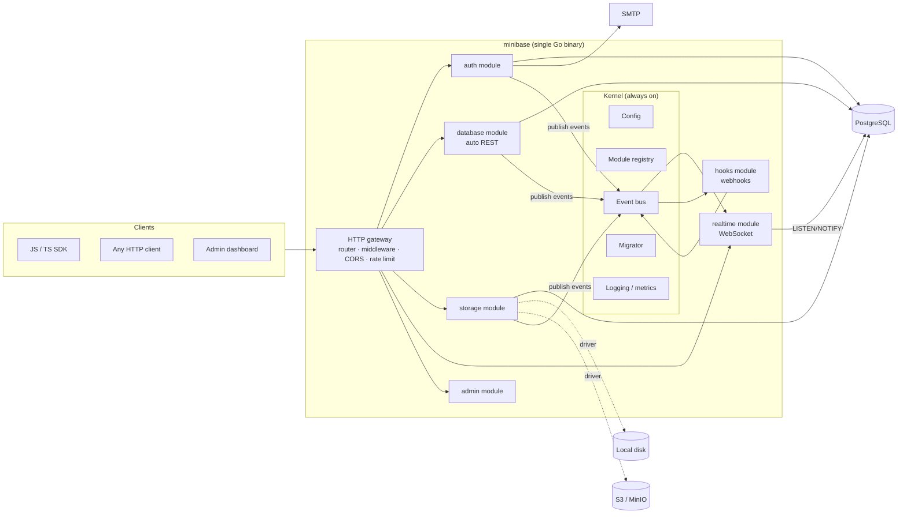
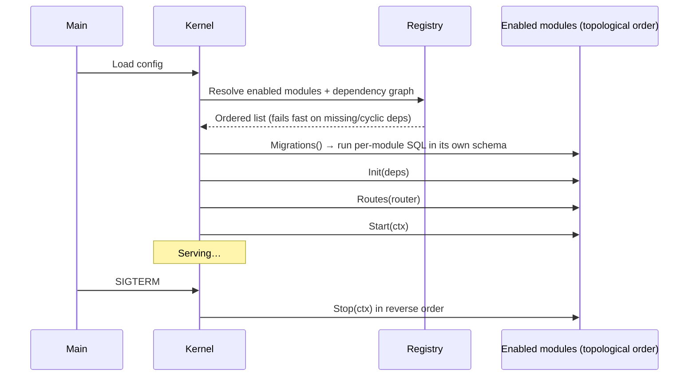
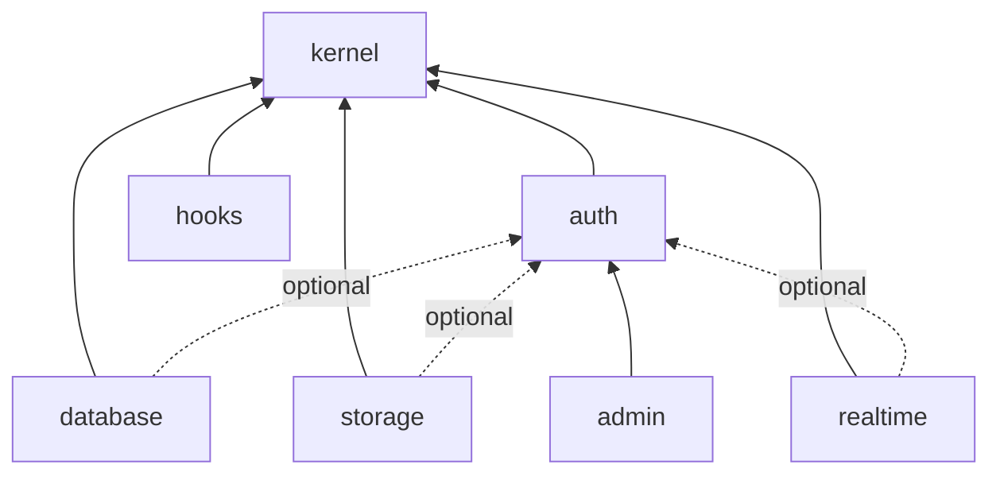

# mini-base — Architecture Design

> Status: **v0.5 — Phase 1 and the admin dashboard (with designer, data tools, API docs and audit log) implemented** · Last updated: 2026-10-15
> Scope: system design for v1. Implementation details live in code and ADRs (`docs/adr/`).

---

## 1. Goals and non-goals

### Goals

| # | Goal | Measurable target |
|---|------|-------------------|
| G1 | **Lightweight** — runs comfortably on a $5 VPS or a Raspberry Pi | Core image < 30 MB, idle RAM < 50 MB (excluding Postgres) |
| G2 | **Modular** — enable only what you need | Each module toggled by config; a disabled module costs zero routes, goroutines, and DB tables |
| G3 | **Familiar** — Firebase/Supabase-like developer experience | Auth, auto REST API over tables, file storage, realtime subscriptions, JS SDK |
| G4 | **Secure by default** | Row-level security enforced in the database, not only in app code |
| G5 | **One-command start** | `docker compose up` gives a working backend |
| G6 | **Contributor-friendly** | Clear module boundaries, one language for the server, documented conventions |

### Non-goals (v1)

- Multi-tenant hosting platform (one mini-base instance = one project).
- Running user code ("edge functions"). v1 offers **webhooks** instead (see §5.6).
- Horizontal auto-scaling. The design *allows* splitting modules into separate processes later, but v1 targets a single node.
- Supporting multiple SQL databases. v1 is PostgreSQL-only (see ADR-0002).

---

## 2. High-level architecture

mini-base is a **modular monolith**: one Go binary (`minibase`) containing every module, where each module is switched on or off at startup. PostgreSQL is the only required dependency.



### Why a modular monolith (not microservices)

Supabase runs ~8–10 containers (GoTrue, PostgREST, Realtime, Storage, Kong, Studio, …), each with its own runtime. That is the opposite of lightweight. A single binary gives:

- one process, one port, one log stream, one image to ship;
- in-process calls between modules (no network hops, no service discovery);
- strict module boundaries are still enforced **in code** (§4), so a module can later be run as its own process with `minibase serve --modules=realtime` if a deployment needs it.

---

## 3. Technology choices

| Concern | Choice | Reason |
|---------|--------|--------|
| Server language | **Go 1.23+** | Static single binary, ~10–20 MB, low memory, excellent concurrency for WebSockets, easy cross-compile (ARM for Pi). See ADR-0001. |
| Database | **PostgreSQL 16+** | Row-level security, LISTEN/NOTIFY, JSONB, mature. See ADR-0002. |
| DB driver | `jackc/pgx/v5` | Fastest Go Postgres driver; native pool; LISTEN support. |
| HTTP router | stdlib `net/http.ServeMux` (Go 1.22+ patterns) + `internal/platform/httpx` | Method + wildcard routing is built in; a ~100-line wrapper adds groups, middleware and JSON 404/405. Zero dependencies. |
| WebSocket | `coder/websocket` | Small, context-aware, maintained. |
| Migrations | Built-in migrator (`internal/platform/migrate` + `postgres.Migrator`) | Plain forward-only SQL per module, embedded with `embed.FS`, advisory-locked, checksummed so edited migrations are rejected. ~150 lines instead of a dependency. |
| Config | env vars only (`MINIBASE_*`), stdlib parser | 12-factor; Docker-friendly; per-module `MINIBASE_<MODULE>_*` namespaces. |
| Logging | `log/slog` (stdlib) | Structured JSON logs, zero dependency. |
| Metrics | Prometheus `/metrics` (optional) | Off by default. |
| Password hashing | Argon2id (`golang.org/x/crypto`) | Current OWASP recommendation. |
| JWT | stdlib (`internal/platform/jwt`, HS256 only) | ~100 lines; refusing every other algorithm avoids the classic `alg` confusion bugs. Asymmetric keys can be added later. |
| Object storage | Local FS driver, S3 driver (`minio-go`) | Local for small installs, S3/MinIO/R2 when needed. |
| SDK | TypeScript, zero runtime deps, ESM + CJS | Works in browser, Node, Deno, Bun. |
| Admin UI | Preact + htm (13 KB, vendored), plain CSS, no build step, embedded in the binary | No Node.js toolchain for contributors; tiny; strict CSP-compatible. See §5.7. |
| Container | Multi-stage build → `gcr.io/distroless/static` | No shell, no package manager; tiny attack surface. |

**Dependency rule:** every third-party library must justify itself. Prefer the standard library.

---

## 4. Module system

### 4.1 The `Module` contract

Every feature is a module implementing one interface, owned by the kernel:

```go
// internal/kernel/module.go
package kernel

type Module interface {
    // Name is the unique, lowercase identifier used in config ("auth", "storage").
    Name() string

    // DependsOn lists modules that must be enabled and initialised first.
    DependsOn() []string

    // Init wires the module. It must not start background work.
    Init(ctx context.Context, deps Deps) error

    // Routes mounts the module's HTTP handlers under its own prefix.
    Routes(r *httpx.Router)

    // Migrations returns the module's embedded SQL migrations (may be nil).
    Migrations() fs.FS

    // Start launches background work (listeners, workers). Must return quickly.
    Start(ctx context.Context) error

    // Stop shuts down gracefully within ctx's deadline.
    Stop(ctx context.Context) error
}

// Deps is everything the kernel hands to a module. Modules never reach for globals.
type Deps struct {
    Config   *ModuleConfig // only this module's MINIBASE_<NAME>_* settings
    DB       *pgxpool.Pool
    Bus      EventBus
    Logger   *slog.Logger  // pre-tagged with module=<name>
    Services *Services     // ports published by other modules
    Env      Environment
}

// Embed kernel.BaseModule to get no-op defaults; implement only Name and Init.
```

The authoritative version is `internal/kernel/module.go`; `internal/modules/example` is the reference implementation to copy.

### 4.2 Lifecycle



### 4.3 Enabling modules

```bash
# env
MINIBASE_MODULES=auth,database,storage,realtime

# or flag
minibase serve --modules=auth,database
```

Rules:

1. `kernel` is always on and is not a module.
2. Enabling a module auto-validates its `DependsOn()`; a missing dependency is a **startup error**, never a silent auto-enable (explicit > implicit).
3. A disabled module registers **no** routes, starts **no** goroutines, and runs **no** migrations.

### 4.4 Module boundaries (the rules that keep this clean)

| Rule | Enforcement |
|------|-------------|
| A module never imports another module's `internal` packages. | Go's `internal/` visibility + `depguard` lint rule. |
| Cross-module calls go through a **port interface** published in `pkg/ports` (e.g. `ports.TokenVerifier`). | Service locator returns interfaces only. |
| Cross-module *notifications* go through the **event bus** (e.g. `auth.user.created`). | Modules never call "back" into a dependent. |
| Each module owns its own Postgres **schema** (`auth`, `storage`, `realtime`, `hooks`). Only that module writes to it. | Migrations per module; DB grants per schema. |
| User data lives in `public` (or user-created schemas). | `database` module exposes only allowed schemas. |

### 4.5 Module catalogue and dependencies



Optional (dotted) dependency = the module works without it but gains features when present (e.g. `database` without `auth` = service-key-only access, no per-user RLS).

| Module | Default | Prefix | Owns schema | One-line purpose |
|--------|:------:|--------|-------------|------------------|
| `auth` | off | `/auth/v1` | `auth` | Users, sessions, access tokens (✅ Phase 1); OAuth, magic links later |
| `database` | off | `/rest/v1` | — (reads `public`) | Auto-generated REST API over tables with RLS (✅ Phase 1) |
| `storage` | off | `/storage/v1` | `storage` | Buckets + files, local or S3 driver, signed URLs |
| `realtime` | off | `/realtime/v1` (WS) | `realtime` | DB change streams, broadcast, presence |
| `hooks` | off | `/hooks/v1` | `hooks` | Outbound webhooks on events, retries |
| `admin` | off | `/_/` | `admin` | Web dashboard: table designer, RLS policies, data tools, SQL editor, users, API docs, audit log, admins (✅) |
| `example` | off | `/example/v1` | `example` | Reference module and template for contributors (Phase 0) |

---

## 5. Module designs

Each module follows the same **hexagonal (ports & adapters)** layout:

```
internal/modules/<name>/
├── module.go          # implements kernel.Module; wiring only
├── config.go          # typed config + defaults + validation
├── domain/            # entities, value objects, domain errors (no I/O)
├── service/           # use cases; depend on ports, not adapters
├── port/              # interfaces the service needs (Repository, Mailer, …)
├── adapter/
│   ├── postgres/      # Repository implementations
│   └── http/          # handlers, DTOs, request validation
└── migrations/        # 0001_init.sql, 0002_….sql (embedded)
```

Dependencies point **inwards only**: `adapter → service → domain`. `domain` imports nothing from the project.

### 5.1 Kernel (always on)

- **Config loader** — env > file > defaults; validates per module; secrets never logged.
- **HTTP gateway** — stdlib `ServeMux` via `httpx.Router`; middleware chain: `RequestID → Logging → Recovery → CORS → MaxBodySize → module routes` (Phase 0). Rate limiting, API key and JWT middleware arrive with the `auth` module. Client IP from `X-Forwarded-For` will only be trusted behind a configured proxy.
- **Event bus** — in-process, typed, async pub/sub with bounded buffers. Interface lets a future NATS/Redis adapter replace it for multi-node.
- **Migrator** — runs each enabled module's embedded migrations in its own schema, tracked in `minibase.migrations`.
- **Health** — `/health/live`, `/health/ready` (checks DB + each module's `Ready()` if implemented).
- **Errors** — single error envelope for every module:

```json
{ "error": { "code": "auth.invalid_credentials", "message": "Email or password is incorrect", "request_id": "01J…" } }
```

### 5.2 `auth` — ✅ Phase 1

**Implemented:** sign-up, password sign-in, refresh with rotation and reuse detection, sign-out, current user. **Later:** password reset and email verification (need SMTP), magic links, OAuth providers (Strategy pattern), admin user management.

```
POST /auth/v1/signup                         {email, password}  → 201 session
POST /auth/v1/token?grant_type=password       {email, password}  → session
POST /auth/v1/token?grant_type=refresh_token  {refresh_token}    → session (rotated)
POST /auth/v1/logout                          (Bearer)           → 204
GET  /auth/v1/user                            (Bearer)           → user
```

**Credentials** (every module API request needs the `apikey` header; checked by the kernel's `platform/authn`):

| Credential | Who uses it | Runs in Postgres as | RLS |
|------------|-------------|---------------------|-----|
| `apikey: <anon key>` | Public clients | `minibase_anon` | enforced |
| anon key + `Authorization: Bearer <access token>` | Signed-in users | `minibase_authenticated` | enforced, `auth.uid()` available |
| `apikey: <service key>` | Trusted servers only | the connection user (table owner) | **bypassed** |

- API keys are opaque random strings (`MINIBASE_ANON_KEY`, `MINIBASE_SERVICE_KEY`), compared in constant time. They are kernel settings because several modules use them; modules exposing an API refuse to start without them.
- Access tokens: HS256 JWTs (15 min) signed with `MINIBASE_AUTH_JWT_SECRET`, implemented on the standard library (`platform/jwt`) and accepting no other algorithm. Claims: `iss`, `sub`, `aud`, `role`, `email`, `sid`, `iat`, `exp`.
- Refresh tokens: 256-bit random, stored only as SHA-256 hashes, single-use. Presenting a used one revokes the whole session (theft signal). Sessions last 30 days, absolute.
- Passwords: Argon2id (19 MiB, t=2, p=1; PHC format so parameters can rise later), with a cap on concurrent hashes. Unknown email and wrong password are indistinguishable, including timing.
- Rate limit: per-IP token bucket on sign-up and token endpoints.
- Shared roles `minibase_anon` and `minibase_authenticated` are created by the kernel's own migration, since several modules rely on them.
- SQL helpers `auth.uid()`, `auth.role()`, `auth.jwt()` read `request.jwt.claims`; request roles can call them but cannot read `auth.*` tables.
- Publishes `auth.user.created`, `auth.session.created`, `auth.session.revoked`. Provides `ports.TokenVerifier` to other modules.
- Known limits: logout does not invalidate already-issued access tokens (they expire within 15 minutes); concurrent refreshes with the same token from one client count as reuse (an SDK must serialise refreshes).

### 5.3 `database` — auto REST API ✅ Phase 1

Turns tables in exposed schemas into a REST API (PostgREST-style, deliberately smaller).

```
GET    /rest/v1/todos?select=id,title&done=eq.false&order=created_at.desc&limit=20&offset=0
POST   /rest/v1/todos                 object or array of objects (same keys in every object)
PATCH  /rest/v1/todos?id=eq.42        object; at least one filter required
DELETE /rest/v1/todos?id=eq.42        at least one filter required
Prefer: return=representation        POST/PATCH/DELETE return the affected rows
```

Operators: `eq, neq, gt, gte, lt, lte, like, ilike` (`*` = wildcard), `in.(a,b,"c,d")`, `is.null|true|false|unknown`, any of them negated with `not.`. Filters are ANDed.

**Design:**

- **Schema cache** — reads `pg_catalog` at start for the exposed schemas (`MINIBASE_DATABASE_SCHEMAS`, default `public`). An unknown table or column triggers one reload (throttled to once per second), so new tables work without a restart.
- **Query builder** (`domain/`, pure and unit-tested) — validates every identifier against the cache, binds every value as a parameter, and casts it in SQL with the column's own type: `"id" = ($1::text)::bigint`. Postgres builds the JSON response (`json_agg`), and inserts and updates go through `json_populate_record(set)`, so no type mapping happens in Go.
- **Security via Postgres RLS** — each request runs in its own transaction:

```sql
BEGIN [READ ONLY];
SET LOCAL ROLE minibase_authenticated;                           -- or minibase_anon; none for service
SELECT set_config('request.jwt.claims', $1, true),
       set_config('statement_timeout', $2, true);
-- generated, parameterised statement
COMMIT;
```

```sql
ALTER TABLE public.todos ENABLE ROW LEVEL SECURITY;
CREATE POLICY own_rows ON public.todos FOR ALL TO minibase_authenticated
  USING (user_id = auth.uid()) WITH CHECK (user_id = auth.uid());
```

- **Secure by default** — anon and signed-in callers are refused (403, with the fix in the message) for tables without RLS enabled, views not created `WITH (security_invoker = true)`, and materialized views and foreign tables. The service key is exempt. `MINIBASE_DATABASE_ALLOW_TABLES_WITHOUT_RLS=true` turns the guard off (unsafe).
- **Grants** — the module's migration grants table privileges in `public` to the request roles, including for tables created later by the same database user. RLS then decides row access.
- **Errors** — Postgres errors caused by the request map to 400/403/409 with Postgres's message (e.g. RLS `WITH CHECK` failures → 403). Others are an opaque 500.
- **Not yet:** embedded relations, `rpc/`, counts (`Content-Range`), upsert, `Accept-Profile` schema switching.

### 5.4 `storage`

- **Buckets** (public/private, max file size, allowed MIME types) and **objects** metadata in schema `storage`; bytes in a **driver**:

```go
type BlobStore interface {          // port — Strategy pattern
    Put(ctx context.Context, key string, r io.Reader, meta ObjectMeta) error
    Get(ctx context.Context, key string) (io.ReadCloser, ObjectMeta, error)
    Delete(ctx context.Context, key string) error
    SignedURL(ctx context.Context, key string, ttl time.Duration) (string, error)
}
// adapters: localfs (default), s3 (S3, MinIO, Cloudflare R2, Backblaze B2)
```

- Access control = **RLS on `storage.objects`**, same mechanism as `database`, so one policy language for data and files.
- Streaming uploads/downloads (never buffer whole files in memory); range requests; signed URLs for private files.
- Image transforms are **out of scope** for v1 (can be a future optional module).

### 5.5 `realtime`

One WebSocket endpoint, three channel types (mirrors the Supabase mental model):

| Channel | Source | Use |
|---------|--------|-----|
| `db:<schema>.<table>[:filter]` | Postgres change events | Live queries |
| `broadcast:<topic>` | Clients | Chat, cursors, ephemeral messages |
| `presence:<topic>` | Clients | Who is online |

- **Change capture (v1): triggers + `pg_notify`.** Enabling realtime on a table installs a trigger that sends `{table, op, id}` (small payload — NOTIFY is limited to 8 KB). The server then **re-reads the row as the subscriber's role**, so RLS decides who may see it. No WAL/logical replication setup required → works on any managed Postgres.
- Logical replication (`pgoutput`) is a planned **driver swap** behind a `ChangeSource` port for high-throughput installs.
- Hub/subscriber model: one goroutine per connection for writes, bounded send queue; slow consumers are disconnected (back-pressure), never allowed to block the hub.
- Heartbeats every 30 s; JWT expiry closes the socket unless the client refreshes the token over the socket.

### 5.6 `hooks`

- Subscribes to bus events (`auth.user.created`, `db.insert.public.orders`, `storage.object.created`, …).
- Delivers HTTP POST to configured URLs, **HMAC-SHA256 signed**, with exponential back-off retries.
- Uses a Postgres-backed queue (`hooks.deliveries`, `SELECT … FOR UPDATE SKIP LOCKED`) — durable without adding Redis.
- This is the v1 answer to "cloud functions": your logic lives in your own service; mini-base calls it.

### 5.7 `admin` — ✅ dashboard (built ahead of storage and realtime)

Web dashboard at `/_/` with a JSON API at `/_/api`. Pages:

| Page | Contents |
|---|---|
| Overview | Server, database, tables without RLS |
| Tables | Browse, filter, sort and page rows; add, edit and delete rows by primary key; CSV export and import; **table designer** (new tables, add and drop columns, drop tables); RLS on or off; **policy templates**; per-table **API docs** with curl and JavaScript examples |
| SQL editor | Scripts, saved snippets (per admin), run history |
| Users | App users (when `auth` is enabled) |
| API and keys | URL, anon key, service key (masked), auth examples |
| Audit log | Who did what, filterable by kind of action and admin |
| Admins | Add (with a generated password), reset password, sign out everywhere, remove |
| Settings | Every `MINIBASE_*` variable in effect, secrets hidden |

- **Frontend without a build step.** Plain HTML, CSS and ES modules embedded in the binary with `embed.FS`. The only third-party code is the 13 KB Preact + htm bundle, vendored with its licence and checksum (`web/assets/vendor`). No Node.js is needed to build or contribute.
- **Separate operator accounts** in the module's own `admin` schema (Argon2id, at least 12 characters), created with `minibase admin create` or bootstrapped from `MINIBASE_ADMIN_EMAIL` / `_PASSWORD` when none exist. They work with or without the `auth` module.
- **Sessions** are random 256-bit tokens stored hashed, in an `HttpOnly`, `SameSite=Strict` cookie scoped to `/_/` (12 h). Changing a password ends every session. Sign-in is rate-limited per IP and takes the same time for unknown emails.
- **CSRF defence in depth:** every write needs the `X-Minibase-Admin` header (custom headers force a CORS preflight the server never grants), and is refused if `Sec-Fetch-Site` is `cross-site` or `Origin` doesn't match the host.
- **Strict CSP:** `script-src 'self'`, no inline script, `frame-ancestors 'none'`.
- **SQL editor** runs as the connection user on a connection *removed from the pool and closed afterwards*, so `SET ROLE`, `search_path` changes or open transactions cannot leak into API traffic. Each script has a statement timeout (30 s), results are capped (500 rows per statement), and every run is logged with the admin's email.
- **Table editor** binds every value and converts it with the column's type via `json_populate_record`. It identifies rows by primary key (tables without one are read-only), refuses writes to generated columns, and hides internal schemas (`auth`, `admin`, `minibase`, …).
- **Table designer** turns forms into DDL in the domain layer (`domain/ddl.go`): new names must match `^[a-z_][a-z0-9_]{0,62}$` and are still quoted, types and default expressions come from allow-lists, literal defaults are escaped and run with `standard_conforming_strings` on, and all statements of one change run in one transaction with a 5 s lock timeout. Drops never cascade, and dropping a table needs its name typed back. Every designer endpoint accepts `?preview=1` and returns the SQL without running it; the UI shows that preview live, so server-side validation is also the form's validation. New tables get RLS on by default.
- **Policy templates** (anyone can read, signed-in users can read or insert, owners manage or read their rows) compile to `CREATE POLICY` for `minibase_anon` / `minibase_authenticated`. Owner templates require a `uuid` column and use `auth.uid()`. A "custom" template takes USING / WITH CHECK expressions (admins can run any SQL anyway).
- **Data tools.** Row filters (`filter=column:op:value`) bind values and cast them to the column's catalog type. CSV export streams `col::text` per row (NULL becomes an empty field). CSV import maps the header to columns, skips generated columns (so an export can be re-imported), inserts in batches of 500 with `json_populate_recordset` inside **one transaction**, and reports the failing line range. Uploads are bounded by `MINIBASE_HTTP_MAX_BODY_BYTES`; exports and imports get a 10-minute write deadline.
- **Audit log** (`admin.audit_log`, ADR-0006): sign-ins (and failures), admin changes, SQL runs with the query, schema and policy changes with the SQL, row edits with the key, imports, exports, user deletes. The acting admin travels in the request context (`service.WithActor`); `minibase admin` records as `cli`. SQL history is read back from the log, so there is no second table to keep in sync. Entries older than `MINIBASE_ADMIN_AUDIT_RETENTION` (90 days) are purged hourly. Admins can run SQL, so the log is a record, not tamper-proof.
- **Managing admins** from the browser: you can't delete yourself, and deleting the last admin is refused atomically (all account rows are locked first). Resetting another admin's password returns a generated one once and signs them out.
- **Settings and keys.** The kernel's config reader records every variable it or a module reads (`kernel.Settings`), with secrets masked by name (`*_URL` passwords redacted, `*SECRET*`/`*PASSWORD*` hidden, `*_KEY` other than `ANON_KEY` shortened). The dashboard shows that record, so modules never report settings themselves and new settings appear automatically.
- **Module boundaries:** user management goes through `ports.UserDirectory` (provided by `auth`), never `auth.*` tables. Schema edits publish `ports.EventSchemaChanged`, which makes the `database` module reload its catalog cache. `database` also re-checks the catalog once before refusing a table it believes has no RLS.

---

## 6. Cross-cutting concerns

| Concern | Design |
|---------|--------|
| **Request flow** | Gateway middleware resolves the credential → `Principal` in `context.Context` → module handler → service → repository opens a tx with `SET LOCAL ROLE` + claims. |
| **Validation** | DTOs validated at the HTTP adapter edge; domain constructors enforce invariants (e.g. `domain.NewEmail`). |
| **Errors** | Domain errors are typed (`var ErrUserNotFound = errs.NotFound("auth.user_not_found", …)`); the HTTP adapter maps kinds → status codes in **one** place. |
| **Observability** | `slog` JSON logs with `request_id`, `module`, `user_id`; optional Prometheus metrics; optional OpenTelemetry traces. |
| **Rate limiting** | In-memory token bucket per client IP (`platform/ratelimit`). `X-Forwarded-For` is ignored until trusted-proxy configuration exists. |
| **CORS** | Configurable allow-list; `*` only in dev profile. |
| **Secrets** | `MINIBASE_ANON_KEY`, `MINIBASE_SERVICE_KEY` (≥ 32 chars, different) and `MINIBASE_AUTH_JWT_SECRET` have no defaults; modules that need them refuse to start without them. |
| **API versioning** | URL prefix per module (`/auth/v1`). Breaking changes → `v2` routes side by side. |
| **API contract** | OpenAPI 3.1 spec per module in `api/`, used to generate SDK types and docs. |
| **Graceful shutdown** | SIGTERM → stop accepting → drain in-flight requests → `Stop()` modules in reverse order → close pool. |

---

## 7. Repository layout

```
mini-base/
├── cmd/
│   └── minibase/            # CLI (serve, migrate, modules, healthcheck, version) + composition root
├── internal/
│   ├── kernel/              # config, module registry & lifecycle, event bus, services, health
│   ├── modules/
│   │   ├── example/         # reference module / template (Phase 0)
│   │   ├── auth/
│   │   ├── database/
│   │   ├── storage/
│   │   ├── realtime/
│   │   ├── hooks/
│   │   └── admin/           # dashboard; web/ holds the embedded UI (no build step)
│   └── platform/
│       ├── errs/            # typed application errors (Kind + stable Code)
│       ├── httpx/           # router, middleware, JSON + error responses
│       ├── migrate/         # loads NNNN_name.sql migrations from embed.FS
│       └── postgres/        # pool connect with retry, migration store
├── pkg/
│   └── ports/               # public interfaces shared between modules
├── api/                     # OpenAPI specs
├── sdk/
│   └── js/                  # @minibase/js client
├── deploy/
│   ├── docker/Dockerfile
│   ├── compose/docker-compose.yml
│   └── compose/.env.example
├── docs/
│   ├── architecture.md      # this file
│   ├── coding-standards.md
│   └── adr/
├── test/
│   ├── arch/                # architecture rules enforced as tests
│   ├── integration/         # kernel + modules against real Postgres (-tags=integration)
│   └── e2e/                 # black-box tests against a running container (later)
├── Makefile
├── .golangci.yml
└── README.md
```

---

## 8. Docker & deployment

### 8.1 Image

Multi-stage, static, non-root:

```dockerfile
# deploy/docker/Dockerfile
FROM golang:1.23-alpine AS build
WORKDIR /src
COPY go.mod go.sum ./
RUN go mod download
COPY . .
ARG VERSION=dev
RUN CGO_ENABLED=0 go build -trimpath \
    -ldflags="-s -w -X main.version=${VERSION}" \
    -o /out/minibase ./cmd/minibase

FROM gcr.io/distroless/static-debian12:nonroot
COPY --from=build /out/minibase /minibase
EXPOSE 8090
USER nonroot:nonroot
ENTRYPOINT ["/minibase", "serve"]
```

Published multi-arch (`linux/amd64`, `linux/arm64`) to GHCR.

### 8.2 Compose profiles = modularity at the infrastructure level

There are two independent switches, both set in `deploy/compose/.env`:

| Switch | Controls | Example |
|--------|----------|---------|
| `MINIBASE_MODULES` | features **inside** the minibase process | `auth,database,storage` |
| `COMPOSE_PROFILES` | extra **containers** started next to it | `db` (bundled Postgres), `dev` (Mailpit), `s3` (MinIO) |

PostgreSQL is deliberately *not* a module: modules are code in the binary, while Postgres is a separate server that may live elsewhere. The `db` profile starts a bundled `postgres:16-alpine`; removing it and setting `MINIBASE_DATABASE_URL` points minibase at an external database. `depends_on … required: false` (Compose ≥ 2.20) lets the same file serve both cases, and minibase's own connect-with-retry covers start-up ordering. Postgres is never baked into the minibase image: one process per container keeps the image small and the database replaceable.

See `deploy/compose/docker-compose.yml` for the authoritative file.

### 8.3 Bring-your-own Postgres

Point `MINIBASE_DATABASE_URL` at any Postgres 16+ (Neon, RDS, a local install) and run only the `minibase` container — or the bare binary without Docker.

---

## 9. Testing strategy

| Level | Tooling | What |
|-------|---------|------|
| Unit | `go test`, table-driven | Domain + services with fake ports. No DB. Fast. |
| Architecture | `test/arch` (stdlib `go/parser`) | Fails the build on layering violations from §4.4. |
| Integration | Build tag `integration` + real Postgres (`make test-integration` starts one in Docker) | Repositories, RLS policies, migrations, query builder SQL. |
| Contract | OpenAPI validation in tests | Handlers match `api/*.yaml`. |
| E2E | SDK tests against the built Docker image | Sign up → insert row → realtime event → upload file. |
| Security | `gosec`, `govulncheck`, fuzzing the query parser (`go test -fuzz`) | Injection & parser robustness. |

CI (GitHub Actions): lint → unit → integration → build image → e2e → publish on tag.

---

## 10. Roadmap

| Phase | Deliverable | Exit criteria |
|-------|-------------|---------------|
| **0 — Skeleton** ✅ | Kernel, module registry, config, gateway, migrator, health, Dockerfile, compose, CI | `docker compose up` → `/health/ready` is green; a dummy module can be toggled |
| **1 — Auth + Database** ✅ | Email/password, JWT, refresh rotation, API keys; REST CRUD with RLS | SDK can sign up and CRUD its own rows; another user cannot read them |
| **2 — Storage** | Buckets, local driver, signed URLs, RLS on objects; S3 driver | Upload/download via SDK with policies |
| **3 — Realtime** | WS hub, db change channels, broadcast, presence | SDK receives inserts on a table filtered by RLS |
| **Dashboard** ✅ | `admin` module, built early (ahead of Phases 2–3): editor, designer, policy templates, CSV, snippets, API docs, audit log, admins | Build a table, secure it and call it from an app without writing SQL |
| **4 — DX** | JS SDK v1, docs site, OAuth providers, magic link; storage and realtime pages in the dashboard | New user to working app in < 10 minutes |
| **5 — Extensions** | `hooks` module, Prometheus metrics, logical-replication change source | — |

---

## 11. Open questions

1. **Project name / Go module path** — `github.com/<you>/mini-base`? Needed before Phase 0.
2. **Licence** — Apache-2.0 (patent grant, business-friendly) vs MIT (simplest). Recommendation: Apache-2.0.
3. **SQLite "lite mode"** — worth a v2 spike? Would require app-level policies instead of RLS (see ADR-0002).
4. ~~Admin UI framework~~ — decided: Preact + htm without a build step (ADR-0005).
